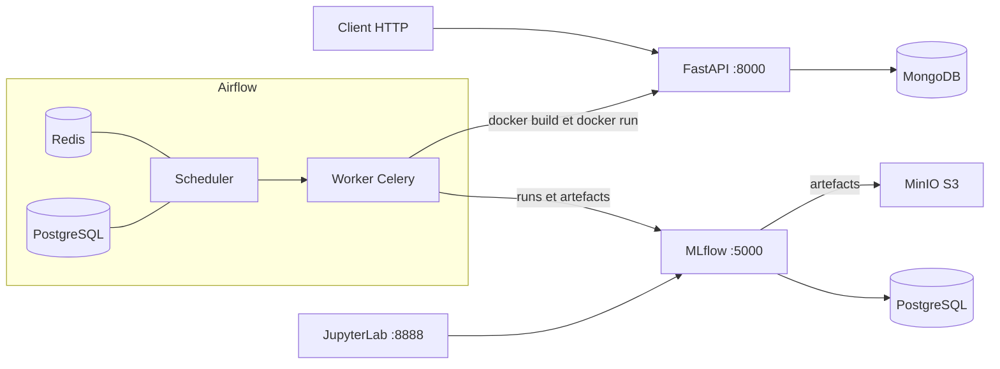
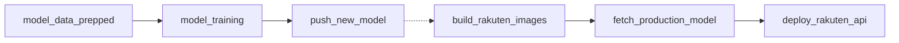

# Rakuten MLOps : classification multimodale de produits e-commerce

Mise en production d'un modèle de classification de produits de la marketplace Rakuten
France, sur les 27 catégories du catalogue. Le dépôt contient la chaîne complète :
préparation des données, entraînement tracé dans MLflow, enregistrement dans un Model
Registry, déploiement automatisé d'une API de prédiction, le tout orchestré par Airflow
et conteneurisé avec Docker Compose.

## Ce que fait la chaîne

* Préparation reproductible des données : nettoyage de texte multilingue, split stratifié, encodage des 27 classes.
* Entraînement tracé dans MLflow : hyperparamètres, métriques par epoch, artefacts.
* Enregistrement dans le Model Registry, passage en stage `Production` et archivage de la version précédente.
* Déploiement automatisé : récupération du modèle en production, build des images, lancement de l'API, vérification de disponibilité bloquante.
* API FastAPI avec authentification JWT et base utilisateurs MongoDB.
* Orchestration Airflow en CeleryExecutor, et contrôles d'intégration continue sur GitHub Actions.

## Architecture



Deux choix structurent le projet :

1. **Le code ML vit dans `plugins/src`**, monté sur le `PYTHONPATH` des conteneurs
   Airflow. Les DAGs ne contiennent que l'orchestration et importent des fonctions
   utilisables et testables indépendamment.
2. **Le worker Airflow a accès au socket Docker de l'hôte.** C'est ce qui lui permet de
   construire les images de l'API et de lancer les conteneurs de production depuis une
   tâche de DAG, sans agent de déploiement supplémentaire.

## Les deux pipelines



| DAG | Tâches | Rôle |
|---|---|---|
| `1_pipeline_entrainement_dag` | `model_data_prepped`, `model_training`, `push_new_model` | Prépare les données, entraîne le Conv1D texte, logge le run dans MLflow et promeut le modèle en `Production` |
| `2_deployment_pipeline_dag` | `build_rakuten_images`, `fetch_production_model`, `deploy_rakuten_api` | Construit les images, récupère le modèle en production et déploie l'API, en échouant si elle ne répond pas |

Les deux DAGs se déclenchent séparément : l'enchaînement automatique est écrit mais
commenté. Détail des tâches, de l'architecture du modèle et des hyperparamètres dans
[docs/pipelines.md](docs/pipelines.md).

## API de prédiction

Six routes de prédiction, toutes authentifiées : texte seul (Conv1D, Simple DNN), image
seule (Xception, InceptionV3) et bimodal (fusion pondérée texte et image). Chaque réponse
renvoie le `prdtypecode` prédit, son libellé et le score de confiance du modèle ; les
routes bimodales détaillent en plus la sortie de chaque sous-modèle.

Documentation interactive sur `http://localhost:8000/docs`. Authentification, liste
complète des routes, format des réponses et logique de fusion dans
[docs/api.md](docs/api.md).

## Démarrage rapide

Prérequis : Docker et Docker Compose, `make`, Git, Git LFS, 16 Go de RAM et 32 Go de
disque.

```bash
git lfs install
git clone https://github.com/Ismael-IF/rakuten-mlops-project.git
cd rakuten-mlops-project
git checkout rakuten-final
cd MLops_Multiclass_Rakuten

make init-airflow   # premier lancement seulement
make start
```

Les CSV du challenge doivent être déposés dans `data/raw_csv/` avant le premier run du
pipeline, voir [docs/donnees.md](docs/donnees.md).

| Service | URL |
|---|---|
| MLflow | `http://localhost:5000` |
| JupyterLab | `http://localhost:8888`, token `cd4ml` |
| MinIO, console S3 | `http://localhost:9001` |
| Flower (Celery) | `http://localhost:5555` |
| API FastAPI | `http://localhost:8000`, après exécution du DAG de déploiement |
| Airflow | port non publié par défaut, voir [docs/installation.md](docs/installation.md) |

Identifiants, publication du port Airflow, premier cycle complet, tests et commandes de
nettoyage : [docs/installation.md](docs/installation.md).

## Périmètre actuel

Fonctionne de bout en bout : la préparation des données, l'entraînement du Conv1D texte,
le suivi dans MLflow, la promotion dans le registry, le déploiement de l'API, puis
l'authentification et la prédiction à partir du texte avec le Conv1D.

À connaître avant de cloner : les modèles Simple DNN, Xception et InceptionV3 ne sont pas
versionnés dans le dépôt, et les routes correspondantes échouent au chargement tant que
les fichiers ne sont pas fournis. Le pipeline Airflow n'entraîne que le modèle texte.

Liste complète de ce qui tourne, des limites connues et des pistes d'amélioration dans
[docs/perimetre.md](docs/perimetre.md).

## Stack

Airflow 2.9.1 (CeleryExecutor, Redis, PostgreSQL), MLflow avec backend PostgreSQL et
artefacts sur MinIO compatible S3, TensorFlow et Keras, NLTK, FastAPI et Uvicorn, MongoDB,
JWT avec python-jose et bcrypt, Docker Compose, JupyterLab, GitHub Actions et GitHub
Container Registry, Git LFS pour les modèles.

Structure du dépôt et versions précises dans [docs/installation.md](docs/installation.md).

## Contexte et crédits

Le projet prolonge par son industrialisation un travail de modélisation antérieur sur le
challenge Rakuten France Multimodal Product Data Classification, réalisé pendant le
cursus ML Engineer de DataScientest. La stack Airflow, MLflow et MinIO dérive du
boilerplate public [sachua/mlflow-docker-compose](https://github.com/sachua/mlflow-docker-compose),
d'où subsistent quelques références `cd4ml` dans la configuration.

Documentation [Apache Airflow](https://airflow.apache.org/docs/),
[MLflow](https://mlflow.org/docs/latest/index.html),
[FastAPI](https://fastapi.tiangolo.com/).
