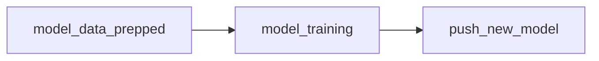
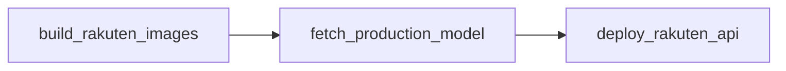

# Pipelines Airflow

Deux DAGs, tous deux en déclenchement manuel (`schedule_interval=None`). Le code
d'orchestration est dans `dags/`, le code métier dans `plugins/src`, monté sur le
`PYTHONPATH` des conteneurs Airflow.

## Pipeline 1 : préparation, entraînement, registry

DAG `1_pipeline_entrainement_dag`, tags `rakuten` et `train`.



| Tâche | Traitement |
|---|---|
| `model_data_prepped` | Charge les trois CSV bruts, nettoie `designation`, construit la colonne `text`, ajoute le libellé de catégorie et la cible encodée, effectue le split train / validation 80/20 stratifié (`random_state=42`) et écrit `X_train_split.csv`, `X_val_split.csv` et `X_test.csv` dans `/data/processed` |
| `model_training` | Tokenise le texte (vocabulaire de 20 000 mots, `maxlen=500`, token `<OOV>`), calcule des poids de classes équilibrés, entraîne le Conv1D et logge dans MLflow sous l'expérience `Rakuten` : métriques de chaque epoch, `history.json` en artefact, modèle sérialisé. Retourne `run_id` et `model_uri` via XCom |
| `push_new_model` | Archive la ou les versions actuellement en stage `Production`, réenregistre le modèle du run courant dans le Model Registry sous le nom `conv1D`, puis le promeut en `Production` |

### Architecture du modèle entraîné

```
Embedding(vocab=20 000, dim=100, input_length=500)
  -> SpatialDropout1D(0.2)
  -> Conv1D(64 filtres, kernel=2, ReLU)
  -> GlobalMaxPooling1D
  -> Dense(27, softmax)
```

| Hyperparamètre | Valeur |
|---|---|
| Optimiseur | Adam, `learning_rate=1e-3` |
| Perte | `sparse_categorical_crossentropy` |
| Epochs | 40 au maximum |
| Batch | 64 |
| Early stopping | sur `val_loss`, patience 5, restauration des meilleurs poids |
| Poids de classes | `balanced`, calculés sur la distribution d'entraînement |

Le pipeline entraîne le modèle texte Conv1D. Les modèles image et bimodaux issus de la
phase de modélisation sont servis par l'API mais ne sont pas réentraînés par ce DAG, voir
[perimetre.md](perimetre.md).

### Comparaison challenger / production

`plugins/src/model_validation/validate_model.py` implémente le garde-fou qualité :
calcul des métriques macro (accuracy, précision, rappel, F1) du nouveau modèle et du
modèle en production, plancher absolu de F1 à 0.40, et exigence de dépasser l'ancien
modèle de plus de 1 pour cent (`_eta = 0.01`).

Ce module n'est pas encore branché comme tâche du DAG : `push_new_model` promeut
actuellement le modèle sans condition.

## Pipeline 2 : déploiement de l'API

DAG `2_deployment_pipeline_dag`, tags `rakuten` et `cd`.



| Tâche | Traitement |
|---|---|
| `build_rakuten_images` | Exécute `rakuten_api/setup.sh` : build des images `mon_api_rakuten`, `authentication_image`, `authorization_image` et `prediction_image` |
| `fetch_production_model` | Interroge le Model Registry, identifie la version en stage `Production` du modèle `conv1D`, télécharge l'artefact `production_model` et copie le fichier `.pkl` vers `app/models/trained_models/final_model.pkl`. La tâche échoue explicitement si aucune version n'est en production |
| `deploy_rakuten_api` | Supprime les conteneurs existants, lance MongoDB puis l'API sur le réseau Docker du projet en injectant les variables MLflow, S3 et `DB_URL`, attend le chargement de TensorFlow puis interroge `/docs`. Si l'API ne répond pas, la tâche affiche les dernières lignes de log du conteneur et sort en erreur |

Le modèle promu en production se retrouve ainsi servi par l'API sans intervention
manuelle. Le `TriggerDagRunOperator` reliant le premier DAG au second est écrit dans
`1_pipeline_entrainement_dag.py` mais commenté : les deux pipelines se lancent
séparément.

## Variables d'environnement injectées dans les conteneurs Airflow

| Variable | Valeur |
|---|---|
| `MLFLOW_TRACKING_URI` | `http://mlflow-webserver:5000` |
| `MLFLOW_S3_ENDPOINT_URL` | `http://s3-artifact-storage:9000` |
| `AWS_ACCESS_KEY_ID` et `AWS_SECRET_ACCESS_KEY` | identifiants MinIO |
| `PYTHONPATH` | complété par `/opt/airflow/plugins` |
| `AIRFLOW__CORE__EXECUTOR` | `CeleryExecutor` |

Volumes montés : `./dags`, `./logs`, `./plugins`, `./rakuten_api`, `./data` sur `/data`,
et le socket `/var/run/docker.sock` qui autorise le worker à piloter Docker.
